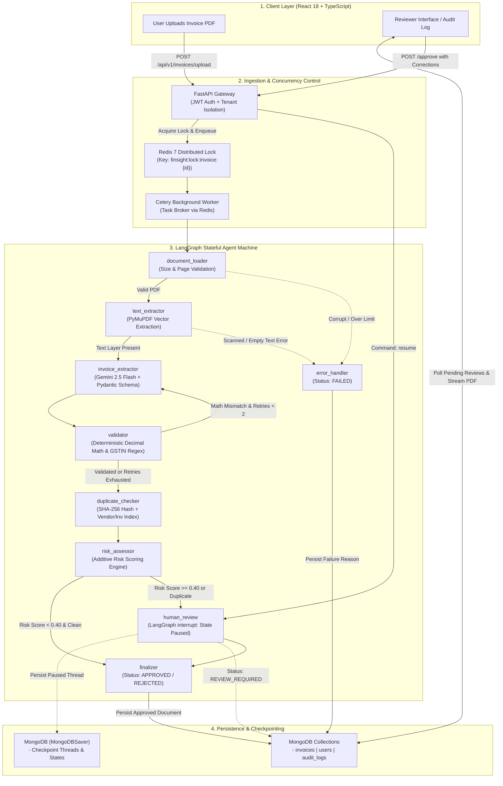

# FinSight AI — Agentic Financial Document Processing Platform

FinSight AI is a production-grade, agentic AI platform designed for automated invoice processing, financial reconciliation, and accounts payable (AP) workflows. It combines asynchronous task queuing, structured LLM extraction, deterministic financial validation, multi-layer fraud detection, and stateful Human-in-the-Loop (HITL) orchestration into a resilient modular monolith.

---

## Complete Project Flow

The following diagram illustrates the complete end-to-end lifecycle of a financial document—from initial browser upload to autonomous agentic verification, checkpointed human review, and persistent database finalization.

---

## 1. WHAT: System Capabilities & Core Modules

FinSight AI eliminates manual data entry and invoice auditing errors through autonomous agentic workflows:

* **Asynchronous Document Processing**: Ingests multi-page invoices via non-blocking Celery workers, offloading compute-heavy parsing from the REST API.
* **Structured Data Extraction**: Employs Google Gemini 2.5 Flash with Pydantic v2 schemas to convert unstructured invoice text into structured data (vendor details, buyer details, dates, currencies, line items, and tax totals).
* **Deterministic Business Rule Validation**: Reconciles itemized sums against tax components and grand totals using cent-exact arithmetic without relying on LLM guesswork.
* **Cryptographic & Semantic Duplicate Detection**: Identifies identical files using SHA-256 byte hashing, and identifies business duplicates using composite tenant-scoped vendor and invoice indices.
* **Checkpointed Human-in-the-Loop Review**: Automatically halts the LangGraph workflow when high risk or discrepancies are flagged, persisting state to MongoDB and allowing reviewers to make inline corrections and resume execution.
* **Immutable Audit Trail & Analytics**: Captures every state transition, LLM extraction round, human correction, and approval event in a queryable audit log.

---

## 2. HOW: Engineering Architecture & Execution Flow

### A. Non-Blocking Ingestion & Idempotency
1. The client uploads a digital PDF via the React interface.
2. FastAPI validates the file extension and MIME type, writes the raw document to isolated storage, creates an initial record (`status: UPLOADED`), and enqueues a Celery task.
3. The Celery worker acquires a Redis distributed lock (`finsight:lock:invoice:{id}`). If a duplicate task is dispatched or retried, the lock prevents concurrent processing.

### B. Pure Digital Text Extraction
1. `document_loader` validates that file size (≤ 20 MB) and page count (≤ 50 pages) remain within system thresholds.
2. `text_extractor` executes via **PyMuPDF (`fitz`)**, reading raw character streams directly from the PDF DOM.
3. If a document lacks extractable text (e.g., scanned image or empty PDF), the pipeline aborts immediately with a user-friendly error rather than wasting tokens on empty inputs.

### C. Agentic Extraction & Self-Correction Loop
1. `invoice_extractor` sends the extracted text to **Gemini 2.5 Flash** with instructions for structured JSON output adhering to the `ExtractedInvoice` Pydantic model.
2. `validator` parses the output and runs deterministic validation checks:
   - **Math Consistency**: `subtotal + cgst + sgst + igst == grand_total` (tolerance: $\pm 0.05$).
   - **Line Items**: $\sum (\text{quantity} \times \text{unit\_price}) \approx \text{subtotal}$.
   - **Date Chronology**: Verifies `due_date >= invoice_date`.
   - **Format Rules**: Verifies Indian GSTIN format via regex `^\d{2}[A-Z]{5}\d{4}[A-Z][A-Z\d]Z[A-Z\d]$`.
3. If math or schema validation fails, the LangGraph state machine triggers a conditional retry loop back to `invoice_extractor` (up to 2 iterations), supplying the exact validation errors back to the model as feedback for self-correction.

### D. Fraud Scoring & Stateful Interrupt
1. `duplicate_checker` runs two checks within the user's tenant:
   - Exact file hash match against existing SHA-256 hashes.
   - Exact composite match on `(user_id, vendor_name, invoice_number)`.
2. `risk_assessor` aggregates missing fields, validation failures, low extraction confidence, and duplicate flags into an additive risk score ($0.0 \to 1.0$).
3. **Routing Decision**:
   - **Low Risk ($< 0.40$) & No Errors**: Routes directly to `finalizer` (`status: APPROVED`).
   - **High Risk ($\ge 0.40$) or Inconsistencies**: Enters `human_review`, which triggers LangGraph’s native `interrupt()`.
4. Execution yields safely. The entire execution graph is serialized and persisted into MongoDB via `MongoDBSaver`.

### E. Human Review & Workflow Resumption
1. Flagged invoices appear in the React **Review Queue** with highlighted risk flags and discrepancies alongside an authenticated PDF viewer.
2. The reviewer can edit fields directly in the UI.
3. On clicking **Approve**, the backend invokes `graph.invoke(Command(resume=corrections), config={"configurable": {"thread_id": invoice_id}})`.
4. LangGraph restores the exact execution state, updates fields with human overrides, recalculates totals, transitions the record to `APPROVED`, writes to the audit trail, and releases all resources.

---

## 3. WHY: Key Architectural & Design Decisions

| Decision | Why It Was Chosen Over Alternatives |
|---|---|
| **LangGraph with `MongoDBSaver`** *(vs. Stateless Scripts / Linear Chains)* | Real document verification is non-linear and event-driven. Invoices can require multiple self-correction loops or remain in human review for days. LangGraph serializes execution state to MongoDB without holding open database transactions, blocking threads, or consuming worker memory while paused. |
| **PyMuPDF (`fitz`)** *(vs. Tesseract / OCR Tools)* | 95%+ of modern B2B invoices are digitally exported PDFs containing native vector text layers. PyMuPDF extracts text in milliseconds without heavy external C++ binaries, CPU overhead, or OCR hallucination errors. Scanned documents are rejected at the gate. |
| **Python `Decimal` Precision** *(vs. IEEE-754 Floats)* | Standard binary floating-point arithmetic introduces rounding inaccuracies (e.g., `0.1 + 0.2 != 0.3`). In financial software, fraction-of-a-cent errors lead to audit failure. All tax and reconciliation math is enforced using fixed-point `Decimal`. |
| **Redis Distributed Locks** *(vs. In-Memory Locks)* | In distributed setups with multiple Celery worker nodes, memory locks fail. Redis keys with automatic expiration guarantee cluster-wide task idempotency, preventing duplicate billing or multiple LLM calls during network retries. |
| **Loop-Aware Motor Client** *(vs. Naive Global Connection)* | Celery workers running asynchronous async-to-sync tasks spawn separate event loops across task executions. A naive global Motor client throws `RuntimeError: Event loop is closed`. Our loop-aware singleton binds client instances dynamically to the active running loop. |
| **Modular Monolith** *(vs. Microservices)* | Avoids distributed transaction overhead, network latency, and orchestration complexity while maintaining clear boundary separation between domain services (agents, auth, ingestion, analytics). |
